<p align="center">
  
</p>

<p align="center">
  <a href="https://setidure.com"></a>
  
  
</p>

<br>

```text

                                           xxXXXXXXXxx
                                     x##%%%%%%%@%%%%######x
                                 X#%%%%##%%%%%%@@@@@@@%%%#####Xx
                              xXX#%%%###%%%%%%@@@@@@@@@@@@@%%######Xx*
                           xXXXX####X#%@@@@%@@@@@@@@@%%%%@@@@@@%%#%###%#X
                       XX##########%%@@@@@@@@@@@%Xxx****xxxxxX##%%%%%%%#%%X
                      ##%%%%%%%%%%@%%%%%@@%%%##Xx+++=-========+++xX#%%%%%%@%#X#%#X
                   X%@@@%@%%%%%@@@@%%####XXXXx*+---------------==++*XX#%%@@@@@@@@@%#
                 X%%@@@@@@%%%%%@@Xx*++++++++=-::::::::::::::-----=++*xX#%%@@@@@@@@@#
               #%@@@@@@@@@%%##%X*=-:::..................::::::---==++*xX#%@@@@@@@@@@#
             x*X%%%@@@@@@@@%#Xx*=--::...    ..     ........:::---===++*xX#%@@@@@@@@@@X
            ###%%%%@@@@@@@##x**=---:....             .....::::---====++*xXX%@@@@@@@@@%X
            %%@%@@@@@@@%#XXX*++=---:...               ....:::::---===++**xX#%@@@@@@@@@###
            @@@@@@@@@@#Xxx*xX*+==-::.                     ...::::--==++++*xX#%@@@@@@@@%#%X
           X@@@@@@@@@#Xx***++***=-:.                       ....:::--==+++**X#%%@@@@@@@%#%#
           X@@@@@@@@%#Xx*+++===+Xx=::....             .:-=+*x*****+++=++***x#%%%@@@@@@#x
           X@@@@@@@@%#X*+**++*xxX#%##XXXX*+=-:......::=*x##%%%%%%##Xx*++***xX%@@@@@@@@%%%
           X@@@@@@@@%X*++*++*xxXX###XX####Xx*=------=+*xXXXXxx****xxxxxxx**xX%@@@@@@@@%X
            %@@@@@@%#x+++****+++++=--=+**xXXX*+=---=*xXXXx**+==---==+**x****x#@@@@@@@@%
             @@@@@@%X*++*+++=========*xxxxxxxx=.   :+xXXXXXXxx******+**xx**-.:*%@@@@@@%
             %@@@@@#x:.:=++***xXXxXX#%XXXXx*++*+-.:=**xxxxx**#X######Xxx**+++*#%@@@@@@
             #@@@@#+**+==++*xX##X*x###**xXx++*x=.  .+=++xxx*+*X##**X##Xx**++*x#@@@@@@@
              %@@@##x*+-.==++--*x***xxx*+++=+XX=.   .=*x**++*xxxxxxX****++++*xX%@@@@@%
               %@@%#x*++..==-.:-=====--:---=*+-:.    :++====-------=========+**#@@%##%
              x#%%%X*+++=::::::.........:::-=:.       :===-:::::::::::::::--=++X%%X*X#
              Xx#%%X++==--...            ..::.         :=--:...... ......:--=+*X%%x==*
              +--X%X+==--:....        .:-.  .--.    .:==. .--:....   ....::-=+*X#%%#*=
              -=*##x+==--:..... ....::-=+=+X%@@#*+++X%@@%x*++=-:........:---=+*X####X*
              -*Xx*x++=---::........:::::+X##XxX##%%@%%%%#x+--:..  ...::---==*xX##xxx+
              -=+-*X*+==-=-::.......:.:::-=xXXXXxxxX###Xx+-:::........::---=+*x#%%x*+-
               --=*#x*+===---:::::::::::-=+x##x**++*x###x+--::::::::::---===+*X#%%*=++
               =--*#X**+==----------=*xx**+*xX*=-:::=*xxxX*xx*+=-----=======+xX#%X*+=-
                -=*X#x**+====---==+*x#%#xxX#%%%%%##%%%%##X*x#%%#X+=====+++++xXX##x+=-
                 -+x#Xxx*++========*xX####Xx*+==+**+++xX#%%%%%##X*+====++++*xX#+
                      Xx**+++===------::::..::.....::::-:::-====+===+++++**xXXX
                      XXxx***+==--:::::::::::::-----:...::--------==+++****xX#
                       XXxx****++=-::::::::::::-==----::::::-----=+*****xxXXXx
                        XXxxx*****+--:::.        .      ...::---=+xxxxxxXXX#X
                        XXXXXxxxxx*+=-::.     ......      .::--=*xXXXXX#####
                         #####XXXXXX*++=--::::--=+++=-::::--=+*xX######%%%%#
                         X###%%%########XXXXXXXX##%%#xxXxXXX####%%%%%%%%%%#X
                         XXX##%%%%%####%%%@@@@@@@@@@@@@%%@@@%%%%%%@@@@%%%##X
                       xxxxxxXX#%%%%%%%%%%%@@@@@@@@@@@@@@@@@@@@@@@%@%%###XX
                      #-=*x****xX##%%%%%%%%%%%%%%%%%%%%@@@@@@@@%%%%###XXXXX*
                    X%*::*******+**xX##%%%%%%%%%%%%%@@@@@@@@%%%%%##XXxxxXXXx+
                   #@%=..-**++++++++**xXXXX##%%%%%@@@@@%%%#####XXxxxxxxxxxX*-+X
                 #%%@%+::::=*++===++++++***xxXXXX######XXXXXxxxxxx******xxx+--X%
              X#%%%@@@*-:.. .-++======++***++++++++**********xx***++++***xx=:-*@@
            #%%%%%@@@@X-..     :-========+++++===---=++*********++==++***x=  .*@@@#
          X%%%%%%@@@@@%+:.       .-+======++++===----++*******++++++++**x=   -X@@@@@X
     x#%%%%%%%%%%@@@@@%X+:          :=++=+==========+++*+++*++++=+++++x*.   :=X@@@@@@@%
*X#%%%%%%%%%%%%@@@@@@@@x-:-.          .-***++++++*xx****+++*++++==++*+:    :--X@@@@@@@@@%
%%%%@@@%%%%%%%%%@@@@@@@%*: .:.           -******+***********++====+=.     :-=+X%@@@@@@@@@@X
%%%@@@%%%%%%%%%@@@@@@@@@%x-  ..           .=xx**++++********==-==-       -::==*X%@@@@@@@@@@#
%%%%%%%%%%%%%%%@@@@@@@@@%Xx=:  ::         .:+x**+++=++*****=----.  .   ::.-==++x%@@@@@@@@@@@@%X+
%%%%%%%%%%%%%%%%@@@@@@@@%%X+--:  .:.     .-..-****++=+**+=--:. .... :::  :-----x@@@@@@@@@@@@@@@@
%%%@@@%%%%%%%%%@@@@@@@@@@%x==---.  .. .. :.   .+****++=--:::-*=..:::=: .---:  -X%%%@@@@@@@@@@@@@
%%%%@@@@@@@@@@%%%%@@@@@@@%#::-::--.  -: .:      ---=---::. .-xx: :=-:---:-.   =%%%%@@@@@@@@@@@@@
```

I build **practical AI products** at [Setidure Technologies](https://setidure.com). My work starts with a business problem and ends with something people actually use: document automation, voice and language tech for Indian languages, LLM agents, and the dashboards that make them useful.

<br>

## 🎯 What I work on

<table>
  <tr>
    <td width="50%" valign="top">
      <h3>📄 Document & finance automation</h3>
      Invoice and purchase-order parsing with LLMs, GST workflows and Tally-ready exports.
    </td>
    <td width="50%" valign="top">
      <h3>🗣️ Indian-language voice AI</h3>
      Speech recognition, translation and text-to-speech pipelines — Garo, Marathi, Hindi and more.
    </td>
  </tr>
  <tr>
    <td width="50%" valign="top">
      <h3>🤖 LLM agents & RAG</h3>
      Self-hosted models with Ollama, vector search and human-in-the-loop workflows.
    </td>
    <td width="50%" valign="top">
      <h3>📊 Data & analytics</h3>
      Financial analysis, ML experiments and interactive Streamlit dashboards.
    </td>
  </tr>
</table>

## 🚀 Featured projects

<table>
  <tr>
    <td width="50%" valign="top">
      <h3><a href="https://github.com/321128/linkedin-engagement-assistant">LinkedIn Engagement Assistant</a></h3>
      Tracks AI posts from chosen creators, drafts three comment options for each, and queues them in a dashboard — <b>you</b> post manually, so the account stays clean.
      <br><br>
      
      
    </td>
    <td width="50%" valign="top">
      <h3><a href="https://github.com/321128/RAGSYSTEM">Medical RAG Agent</a></h3>
      Retrieval-augmented question answering over medical documents, with retrieval debugging and an end-to-end deployment guide.
      <br><br>
      
      
    </td>
  </tr>
  <tr>
    <td width="50%" valign="top">
      <h3><a href="https://github.com/321128/backend-Vaakshakti">VaakShakti</a></h3>
      Speech tutor backend: Whisper transcribes the learner, an LLM corrects grammar and coaches in real time.
      <br><br>
      
      
    </td>
    <td width="50%" valign="top">
      <h3><a href="https://github.com/321128/SIP-analysis">Mutual Fund Analytics</a></h3>
      Returns, volatility, Sharpe ratio, drawdown and benchmark comparison against NIFTY 50 and S&amp;P 500 — in an interactive dashboard.
      <br><br>
      
      
    </td>
  </tr>
</table>

## 🧰 Toolbox

<p align="center">
  
</p>
<p align="center">
  
  
  
  
  
</p>

## 🤝 Let's connect

<p align="center">
  <a href="https://setidure.com"></a>
  <a href="https://github.com/Setidure-Technologies"></a>
</p>

<!DOCTYPE html>
<html lang="en"><head><meta charset="utf-8"><meta name="viewport" content="width=device-width,initial-scale=1">
<title>Catch the ball</title>
<style>
html,body{margin:0;height:100%;background:#0b1020;color:#cfd3ea;font-family:system-ui,sans-serif;overflow:hidden;cursor:crosshair}
#hint{position:fixed;top:16px;left:0;right:0;text-align:center;font-size:14px;opacity:.7}
#ball{position:fixed;width:44px;height:44px;border-radius:50%;background:radial-gradient(circle at 35% 30%,#ff8a93,#e11d2e 55%,#8f0a16);box-shadow:0 8px 18px rgba(0,0,0,.5);will-change:transform;left:0;top:0}
#score{position:fixed;bottom:16px;left:0;right:0;text-align:center;font-size:14px}
</style></head><body>
<div id="hint">Try to click the red ball — it runs away from your mouse.</div>
<div id="ball"></div><div id="score">Catches: 0</div>
<script>
const ball=document.getElementById('ball'),score=document.getElementById('score');
let W=innerWidth,H=innerHeight,x=W*0.1,y=H*0.5,vx=2.5,vy=0,mx=-999,my=-999,catches=0;
addEventListener('resize',()=>{W=innerWidth;H=innerHeight});
addEventListener('pointermove',e=>{mx=e.clientX;my=e.clientY});
ball.addEventListener('click',()=>{catches++;score.textContent='Catches: '+catches+' (nice!)';x=Math.random()*(W-60);y=Math.random()*(H-60)});
function tick(){
  const cx=x+22,cy=y+22,dx=cx-mx,dy=cy-my,d=Math.hypot(dx,dy),R=190;
  if(d<R){const f=(R-d)/R*2.6;vx+=dx/(d||1)*f;vy+=dy/(d||1)*f}
  else{vx+=(Math.random()-.5)*.08;vy*=.98;if(Math.abs(vx)<1.6)vx+=Math.sign(vx||1)*.05} // idle: drifts left/right
  vx*=.96;vy*=.94;
  const sp=Math.hypot(vx,vy),m=14;if(sp>m){vx*=m/sp;vy*=m/sp}
  x+=vx;y+=vy;
  if(x<0){x=0;vx=Math.abs(vx)}if(x>W-44){x=W-44;vx=-Math.abs(vx)}
  if(y<0){y=0;vy=Math.abs(vy)}if(y>H-44){y=H-44;vy=-Math.abs(vy)}
  // cornered? hop to a random spot so it's catchable but sneaky
  if(d<60&&(x<4||x>W-48||y<4||y>H-48)){x=Math.random()*(W-60);y=Math.random()*(H-60)}
  ball.style.transform=`translate(${x}px,${y}px) scale(${1+Math.min(sp,12)/40},${1-Math.min(sp,12)/60})`;
  requestAnimationFrame(tick)}
tick();
</script></body></html>
